# Equity Alpha Research

**Do classic price-based stock signals still earn money in large-cap US equities, after trading costs and after correcting for testing many signals at once? And does machine learning add anything over a simple linear combination?**

## Answer

On survivorship-free CRSP data for the S&P 500, 1997–2025:

1. **Of 8 published signals, only short-term reversal survives multiple-testing correction** (rank-IC t = 3.35, Holm-adjusted p = 0.007). Momentum, the 52-week high, Amihud illiquidity and four low-risk signals do not.
2. **Reversal does not survive realistic trading.** It earns 3.4% a year before costs, but trades 38 times its capital a year and breaks even at 9 bps per dollar traded. Net of quoted spreads its Sharpe ratio is 0.11 (t = 0.55). With market impact for a $100M fund it turns to −0.53. Its Fama-French five-factor plus momentum alpha is 0.05% a year (t = 0.02).
3. **Machine learning does not help here.** Out of sample (2002–2025), LightGBM's monthly IC is not significantly higher than ridge's (paired t = 1.48), and no combination of the eight signals beats reversal alone.
4. **Free data gives the wrong answer.** On Yahoo Finance data, which drops companies that failed, every low-risk signal looks 3–4 percentage points a year worse than on CRSP over the same years.

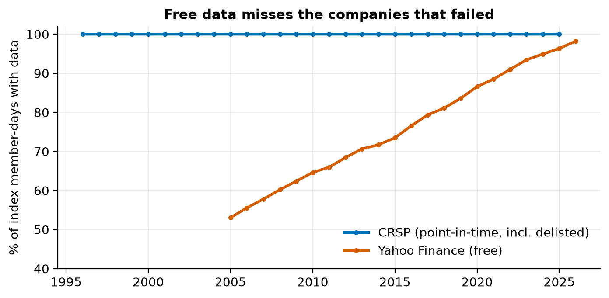

## Data

| | |
|---|---|
| Universe | S&P 500 constituents on each date, 1996–2025 (point-in-time membership from [fja05680/sp500](https://github.com/fja05680/sp500)) |
| Prices and returns | CRSP daily stock file (v2/CIZ) via WRDS: total returns including dividends and **delisting returns**, prices, volume, closing bid and ask |
| Identifiers | Each (ticker, date) mapped to CRSP's permanent ID (PERMNO); 1,245 index stays, 1,189 PERMNOs, **99.9% of member-days matched** |
| Factors | Kenneth French data library: five factors plus momentum, monthly |

**Mapping tickers to PERMNOs was the hardest part.** The membership file labels each company with its latest ticker for its whole history (NextEra appears as NEE in 1996, when it traded as FPL), uses post-bankruptcy tickers (LEHMQ for Lehman), and tickers get reused ("C" was Chrysler before it was Citigroup). Each index stay is matched to the PERMNO whose life overlaps it most, with a 45-entry alias table for bankruptcies and renames (tried only when the own ticker fails), and a gap-filling pass for companies that received a new PERMNO in a merger (Comcast 2002, Fox 2013). Every alias match was checked by company name. Eight short 1990s stays (about 0.1% of member-days) remain unmatched.

**A free-data dry run was built first** (Yahoo Finance, 2005–2026). It covered only 53% of index member-days in 2005 and 76% overall, after removing more than 50 recycled tickers whose free price histories belonged to different companies. It was used to build and debug the pipeline; all conclusions use CRSP.

## Signals

All computed daily from data up to the close of day *t* only, then ranked across that day's index members. Higher always means "the rule likes the stock more".

| Signal | Definition | Source |
|---|---|---|
| Momentum 12-1 | P(t−21) / P(t−252) − 1 | Jegadeesh & Titman (1993) |
| Short-term reversal | −(5-day return) | Jegadeesh (1990), Lehmann (1990) |
| 52-week high | P(t) / max P over 252 days | George & Hwang (2004) |
| Low volatility | −std of 63 daily returns | Ang et al. (2006) |
| Low beta | −252-day beta to the equal-weighted member index | Frazzini & Pedersen (2014) |
| Low idiosyncratic volatility | −21-day market-model residual volatility | Ang, Hodrick, Xing & Zhang (2006) |
| Low MAX | −largest daily return in 21 days | Bali, Cakici & Whitelaw (2011) |
| Amihud illiquidity | log mean(\|r\| / dollar volume), 21 days | Amihud (2002) |

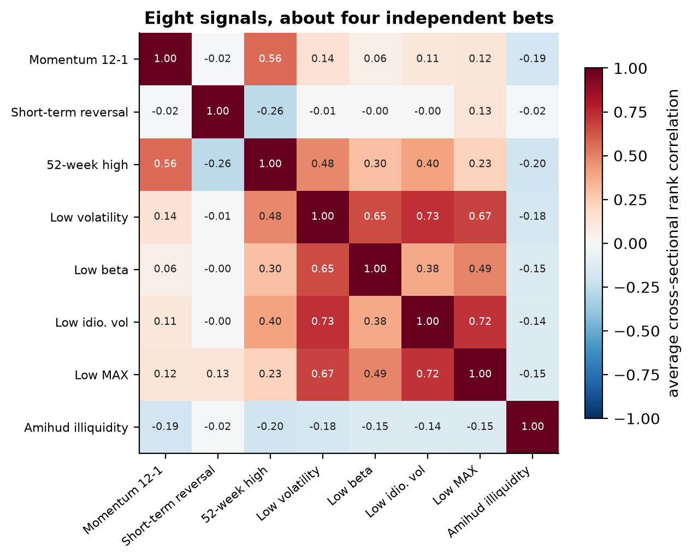

The eight signals are really about four bets: trend (momentum, 52-week high), low risk (volatility, beta, IVOL, MAX, correlations 0.4–0.7), reversal, and liquidity.

## Method

Choices fixed **before** looking at results:

- **Single-signal tests** (1997–2025): daily 21-day rank IC with Newey-West standard errors (20 lags, because forward returns overlap); monthly quintile portfolios; univariate and multivariate Fama-MacBeth regressions. Significance bar **|t| > 3** (Harvey, Liu & Zhu 2016), plus Holm and Benjamini-Hochberg corrections over the 8 signals, and a deflated Sharpe ratio for the best spread.
- **Combination** (test years 2002–2025): month-end ranks predict next month's cross-sectionally ranked return. Expanding walk-forward with one refit per year; training rows are **purged** so no label period overlaps the test year. Equal weight, IC-weighted, ridge and LightGBM (shallow, heavily regularised). Ridge's penalty and LightGBM's tree count are tuned only on the last 20% of each training window.
- **Backtest**: monthly rebalance, long the top fifth and short the bottom fifth ($1 each side), positions drift between rebalances. Costs = half the quoted CRSP bid-ask spread (trailing 21 days) per dollar traded, plus a 25 bps a year borrow fee. Robustness: flat costs 0–30 bps, one-day implementation lag, square-root market impact at $100M and $1B, rank weights, three subperiods, factor regression.

Every signal has an automated **lookahead test** (scrambling all data after day *t* must not change any value up to *t*), and every walk-forward model has one too (scrambling future labels must not change a year's predictions). 58 tests in total.

## Results

### 1. One signal passes, seven do not

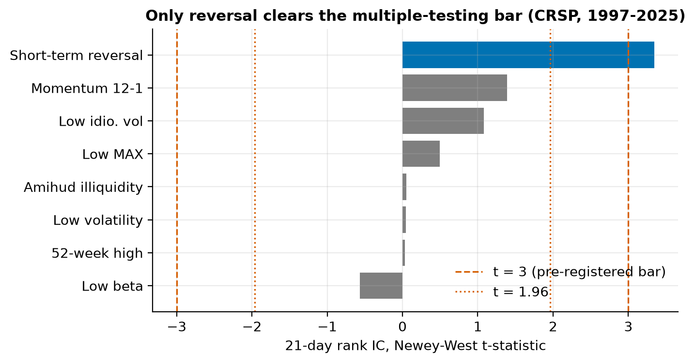

| Signal (CRSP, 1997–2025) | Mean IC | IC t (NW) | Q5−Q1 / yr | Monotone | Fama-MacBeth t (all 8) |
|---|---|---|---|---|---|
| **Short-term reversal** | 0.013 | **3.35** | +5.3% | 1.0 | **3.02** |
| Momentum 12-1 | 0.013 | 1.39 | +1.8% | 0.6 | 1.96 |
| Low idiosyncratic vol | 0.008 | 1.08 | −0.1% | −0.4 | 0.61 |
| Low MAX | 0.004 | 0.50 | −0.0% | −0.3 | 0.64 |
| Amihud illiquidity | 0.000 | 0.05 | +2.6% | 0.7 | 0.68 |
| Low volatility | 0.000 | 0.05 | −2.8% | −0.9 | −0.19 |
| 52-week high | 0.000 | 0.03 | −1.8% | −0.5 | −1.12 |
| Low beta | −0.007 | −0.57 | −3.7% | −0.8 | −0.47 |

Reversal's deflated Sharpe probability (best of 8) is 0.77. Its prediction peaks at a 5-day horizon and fades, as a short-term effect should:

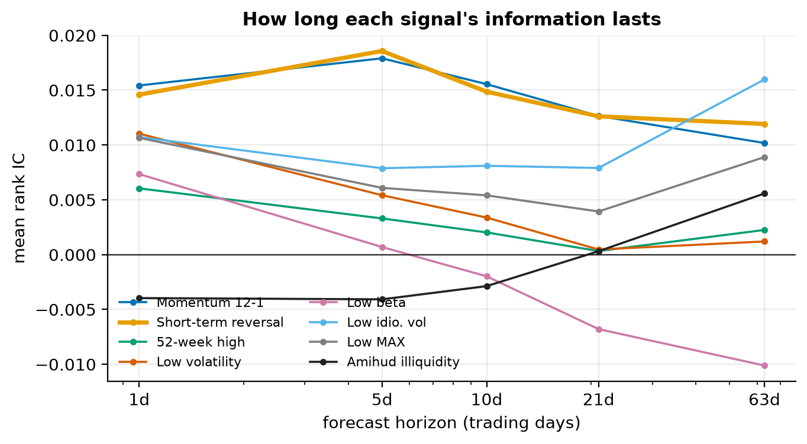
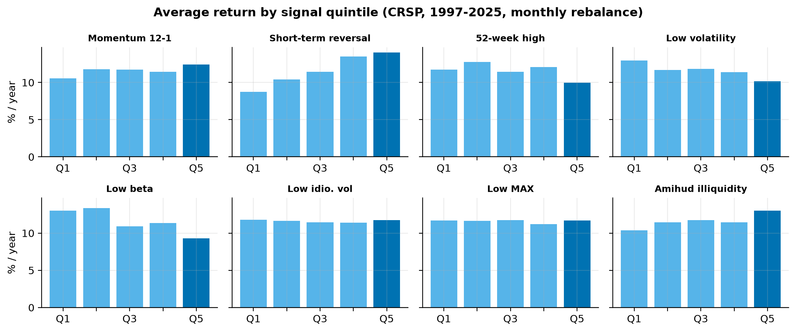

Reversal is weaker in the second half: over 2006–2025 its t-statistic is 2.50, below the bar.

### 2. Survivorship bias changes the conclusions

Same pipeline, same years (2006–2025), only the data source differs:

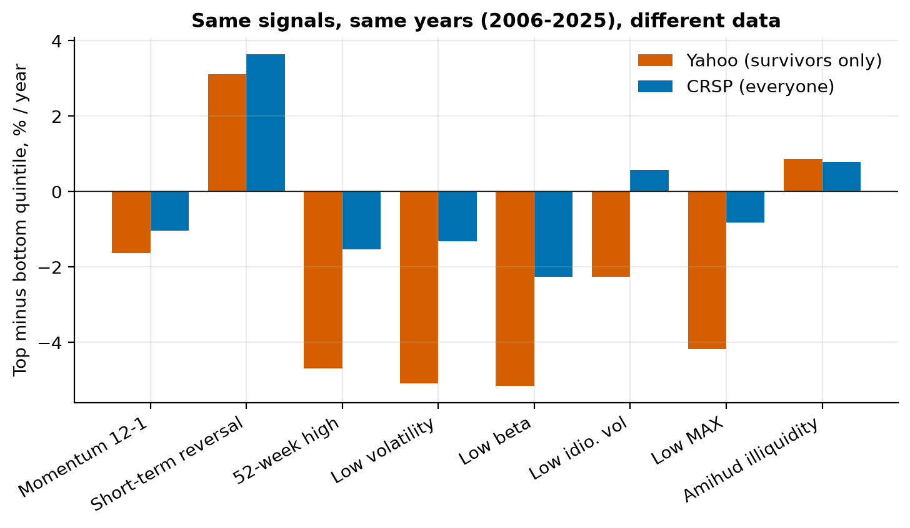

| Q5−Q1 / yr | Yahoo (survivors) | CRSP (everyone) | Shift |
|---|---|---|---|
| Low volatility | −5.1% | −1.3% | +3.8 |
| Low MAX | −4.2% | −0.8% | +3.4 |
| 52-week high | −4.7% | −1.5% | +3.2 |
| Low idiosyncratic vol | −2.3% | +0.6% | +2.9 |
| Low beta | −5.1% | −2.3% | +2.8 |
| Short-term reversal | +3.1% | +3.6% | +0.5 |

The companies missing from free data are mostly volatile stocks that collapsed (Lehman, WaMu, Enron, WorldCom). Dropping them flatters high-risk stocks, so every low-risk signal looks worse. No single shift is statistically significant, but all point the same way. (The Yahoo run ends September 2026, CRSP November 2025.)

### 3. Combining signals and ML do not help

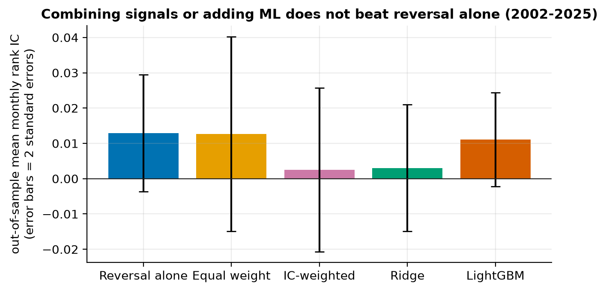

| Out of sample, 2002–2025 | Mean monthly IC | t (NW) | Q5−Q1 / yr |
|---|---|---|---|
| Reversal alone | 0.013 | 1.56 | +3.3% |
| Equal weight | 0.013 | 0.92 | −0.3% |
| IC-weighted | 0.003 | 0.22 | −2.6% |
| Ridge | 0.003 | 0.34 | −1.4% |
| LightGBM | 0.011 | 1.66 | +0.9% |

Paired IC differences: LightGBM − ridge +0.008 (t = 1.48); LightGBM − equal weight −0.002 (t = −0.11). This is consistent with Gu, Kelly & Xiu (2020), where machine-learning gains came mostly from small, illiquid stocks rather than large caps. Ridge's penalty often settles at the top of its grid, and LightGBM usually stops at 20–50 trees: both models' own validation says there is little to learn here.

### 4. Nothing survives trading costs

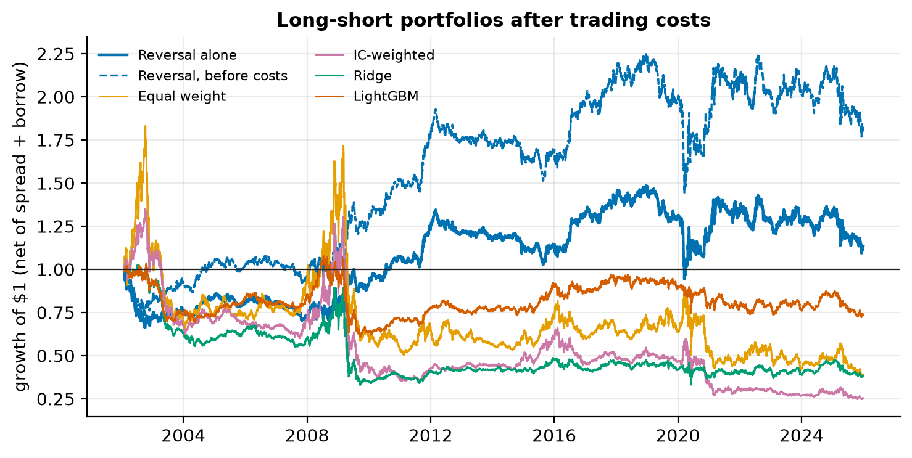

| Monthly long-short, 2002–2025 | Gross | Net | Net Sharpe | Max drawdown | Traded / yr | Break-even |
|---|---|---|---|---|---|---|
| **Reversal alone** | 3.4% | 1.4% | 0.11 (t = 0.55) | −37% | 38× | 9.1 bps |
| LightGBM | 1.1% | −0.5% | −0.04 | −43% | 31× | 3.6 bps |
| Equal weight | 0.2% | −0.9% | −0.04 | −80% | 18× | 0.9 bps |
| Ridge | −1.0% | −2.6% | −0.15 | −68% | 32× | — |
| IC-weighted | −1.9% | −3.3% | −0.15 | −82% | 24× | — |

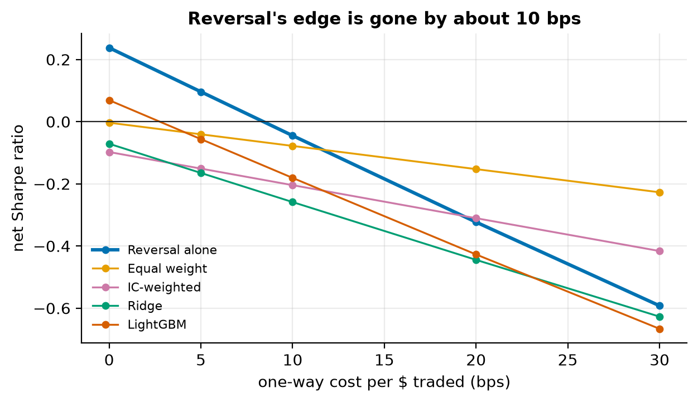
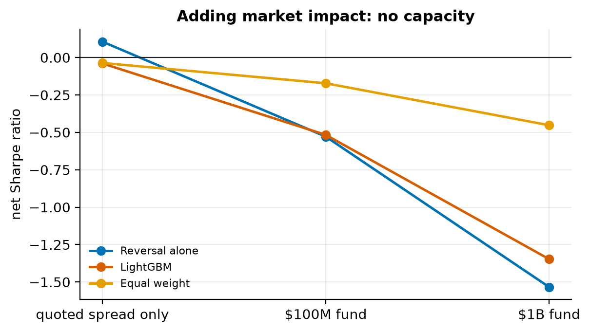

For reversal:

- **Costs.** The median quoted half-spread across stocks is 1.9 bps, but reversal buys last week's losers, which have wider spreads, and pays about 4.6 bps per dollar traded. Its net Sharpe reaches zero at about 10 bps.
- **Bid-ask bounce.** Trading one day later cuts the gross Sharpe from 0.26 to 0.18 and the net Sharpe to 0.03. About a third of the edge is closing-price noise.
- **Capacity.** With square-root market impact, the net Sharpe is −0.53 at $100M and −1.53 at $1B.
- **Stability.** The net Sharpe is 0.00 in 2002–2009, 0.64 in 2010–2017 and −0.09 in 2018–2025.
- **Alpha.** Five factors plus momentum leave an alpha of 0.05% a year (t = 0.02).

**Dollar-neutral is not market-neutral.** The equal-weight combination has a −80% drawdown because the low-risk signals put it long calm stocks and short high-beta ones. Its market beta is −0.52, and momentum (0.69) and profitability (0.73) exposures explain 78% of its variance:

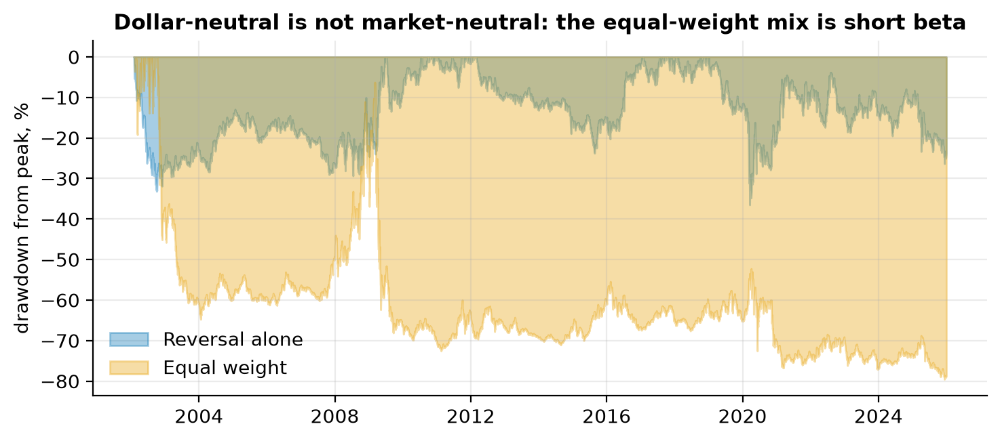

## Limitations

- Membership comes from a public file mapped to CRSP, not CRSP's own constituents table (not in this WRDS subscription); about 0.1% of member-days are unmatched, and the median count is 497 members a day.
- Trades are assumed to execute at the closing price; the one-day lag test is the check on this.
- Impact uses the square-root rule with k = 1; real impact varies by stock, time and execution.
- The borrow fee is a flat 25 bps a year; some stocks cost far more to short.
- Idiosyncratic volatility uses a market model, not the three-factor model of the original paper.
- Portfolios are equal-weighted within quintiles and not beta-neutral; a beta-neutral version is a natural next test (and would be exploratory, since it was not pre-registered).

## Reproduce

Requires WRDS access with CRSP; CRSP data is licensed and is never committed (everything under `data/` is git-ignored).

```bash
pip install -r requirements.txt
# CRSP universe and panel
PYTHONPATH=src python scripts/crsp_map_membership.py YOUR_WRDS_USERNAME
PYTHONPATH=src python scripts/crsp_build_panel.py YOUR_WRDS_USERNAME
# Signals, tests, combination, backtest
DATA=data/processed_crsp PYTHONPATH=src python scripts/build_signals.py
DATA=data/processed_crsp RESULTS=results/step5_crsp EVAL_START=1997-01-01 PYTHONPATH=src python scripts/evaluate_signals.py
DATA=data/processed_crsp RESULTS=results/step6_crsp EVAL_START=1997-01-01 PYTHONPATH=src python scripts/combine_signals.py
DATA=data/processed_crsp PRED=results/step6_crsp RESULTS=results/step7_crsp PYTHONPATH=src python scripts/backtest_strategies.py
# Figures
PYTHONPATH=src python scripts/make_figures.py
# Tests
PYTHONPATH=src pytest -q
```

The free-data comparison uses `scripts/download_data.py` and `scripts/build_panel.py` (Yahoo Finance) followed by the same signal and evaluation scripts with the default settings.

## Repository

```
src/alpha/      universe.py  prices.py  panel.py  crsp.py  signals.py  preprocess.py
                evaluate.py  combine.py  backtest.py
scripts/        data download and panel builds, signals, evaluation, combination, backtest, figures
tests/          58 tests, including lookahead tests for every signal and every walk-forward model
figures/        all charts in this README
```

## References

Amihud (2002); Ang, Hodrick, Xing & Zhang (2006); Bailey & López de Prado (2014); Bali, Cakici & Whitelaw (2011); Fama & French (2015, 2016); Fama & MacBeth (1973); Frazzini & Pedersen (2014); George & Hwang (2004); Gu, Kelly & Xiu (2020); Harvey, Liu & Zhu (2016); Jegadeesh (1990); Jegadeesh & Titman (1993); Lehmann (1990); López de Prado (2018); McLean & Pontiff (2016); Newey & West (1987).